<!-- Generated by scripts/build.py. Edit the script, not this file. -->

<picture><source media="(prefers-color-scheme: dark)" srcset="./assets/hero-dark.svg">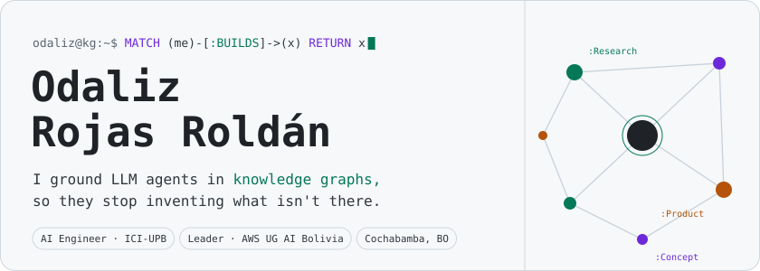</picture>

<picture><source media="(prefers-color-scheme: dark)" srcset="./assets/h-about-dark.svg"></picture>

<picture><source media="(prefers-color-scheme: dark)" srcset="./assets/about-dark.svg">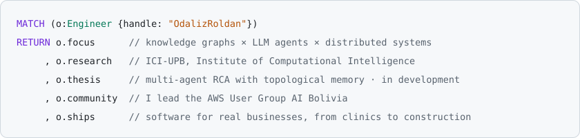</picture>

<picture><source media="(prefers-color-scheme: dark)" srcset="./assets/h-graph-dark.svg"></picture>

<picture><source media="(prefers-color-scheme: dark)" srcset="./assets/graph-dark.svg">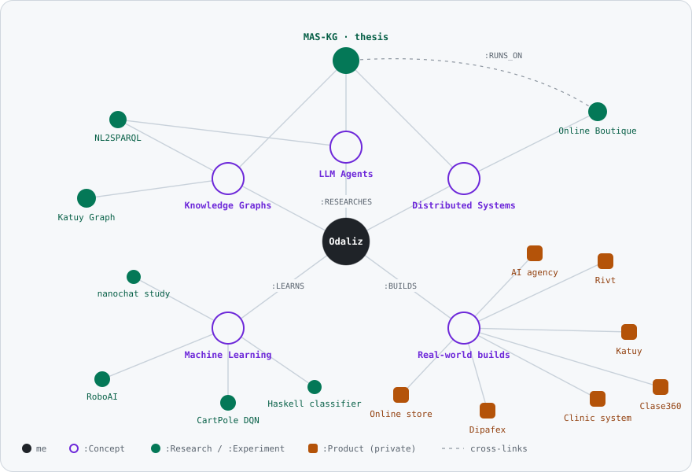</picture>

<picture><source media="(prefers-color-scheme: dark)" srcset="./assets/h-research-dark.svg"></picture>

<picture><source media="(prefers-color-scheme: dark)" srcset="./assets/thesis-dark.svg">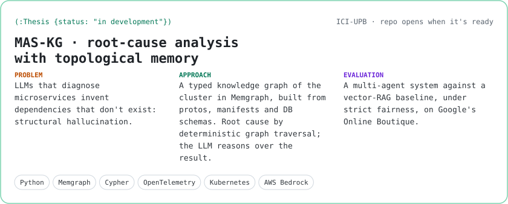</picture>

<picture><source media="(prefers-color-scheme: dark)" srcset="./assets/card-katuy-graph-dark.svg">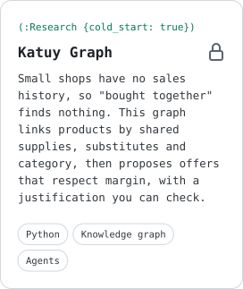</picture>
<picture><source media="(prefers-color-scheme: dark)" srcset="./assets/card-nl2sparql-dark.svg">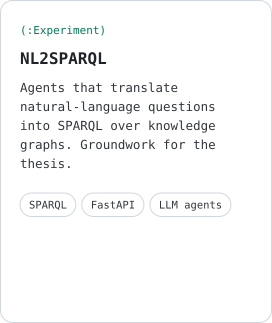</picture>
<a href="https://github.com/OdalizRoldan/microservices-demo-thesis"><picture><source media="(prefers-color-scheme: dark)" srcset="./assets/card-testbed-dark.svg">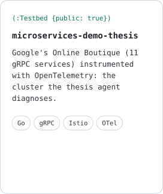</picture></a>

<picture><source media="(prefers-color-scheme: dark)" srcset="./assets/h-lab-dark.svg"></picture>

<a href="https://github.com/OdalizRoldan/RoboAI_VO"><picture><source media="(prefers-color-scheme: dark)" srcset="./assets/lab-roboai-dark.svg">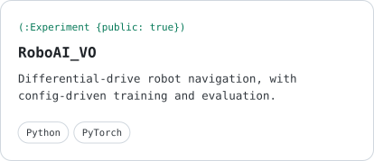</picture></a>
<picture><source media="(prefers-color-scheme: dark)" srcset="./assets/lab-cartpole-dark.svg">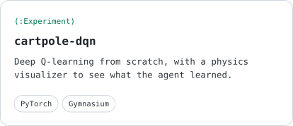</picture>
<a href="https://github.com/OdalizRoldan/project_clasifier_haskell"><picture><source media="(prefers-color-scheme: dark)" srcset="./assets/lab-haskell-dark.svg">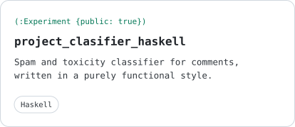</picture></a>
<picture><source media="(prefers-color-scheme: dark)" srcset="./assets/lab-nanochat-dark.svg">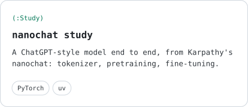</picture>

<picture><source media="(prefers-color-scheme: dark)" srcset="./assets/h-product-dark.svg"></picture>

<picture><source media="(prefers-color-scheme: dark)" srcset="./assets/products-dark.svg">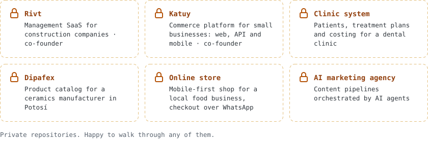</picture>

<picture><source media="(prefers-color-scheme: dark)" srcset="./assets/h-languages-dark.svg"></picture>

<picture><source media="(prefers-color-scheme: dark)" srcset="./assets/languages-dark.svg">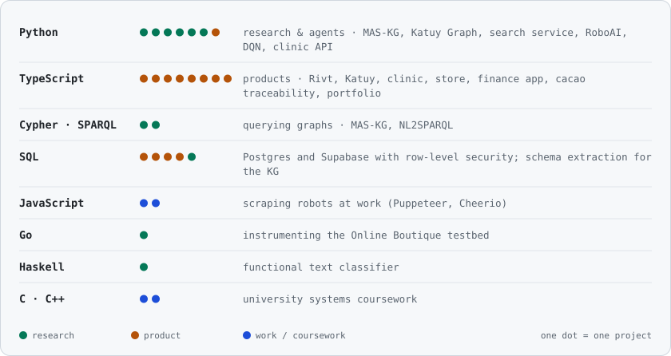</picture>

<picture><source media="(prefers-color-scheme: dark)" srcset="./assets/h-now-dark.svg"></picture>

<picture><source media="(prefers-color-scheme: dark)" srcset="./assets/now-dark.svg">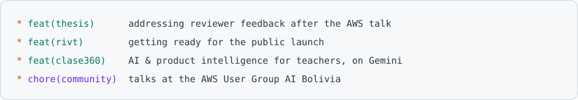</picture>

<picture><source media="(prefers-color-scheme: dark)" srcset="./assets/h-contact-dark.svg"></picture>

<a href="mailto:odaliz.rojas.roldan4417@gmail.com"><picture><source media="(prefers-color-scheme: dark)" srcset="./assets/btn-email-dark.svg"></picture></a>
<a href="https://www.linkedin.com/in/odaliz-rojas/"><picture><source media="(prefers-color-scheme: dark)" srcset="./assets/btn-linkedin-dark.svg"></picture></a>

<picture><source media="(prefers-color-scheme: dark)" srcset="./assets/footer-dark.svg"></picture>

